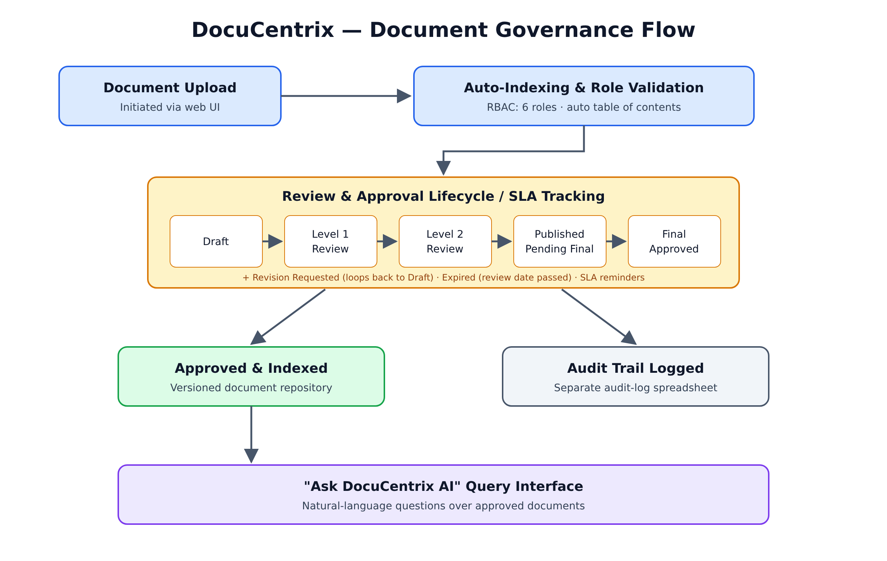

# DocuCentrix — Automated Document Governance & AI Query Platform

[](https://opensource.org/licenses/MIT)
[](#️-tech-stack)

> **Award Notice:** This public repository serves as an open-source, sanitized architectural demonstration based on the award-winning concept that secured **3rd Place at the Infosys Enterprise Hackathon (Sept 2026)**. All sensitive enterprise data, internal endpoints, and client identifiers have been replaced with synthetic data.

---

## 📋 Overview

DocuCentrix is an enterprise-grade document governance platform designed to streamline multi-stage approval workflows, enforce strict access controls, and provide interactive AI-driven document querying.

### Key Capabilities

* **Role-Based Access Control (RBAC):** 6 roles (Admin, Manager, Team Lead, Editor, Final Approver, Viewer) scoped by department and sub-department, plus document classification (Public / Internal / Confidential).
* **Multi-Stage Workflow Automation:** 7-state document lifecycle (Draft → Level 1 Review → Level 2 Review → Published, Pending Final Approval → Final Approved, plus Revision Requested and Expired), with single or multi-stage final approval, SLA reminders and email notifications.
* **Audit Trails & Versioning:** Version history with comparison and rollback, auto-generated table of contents, and a separate audit-log spreadsheet.
* **"Ask DocuCentrix AI":** Natural-language query interface over approved documents. *In this demo the AI response is mocked; `askDocuCentrixAI()` in `Code.gs` is the integration point for a Gemini API call.*

---

## 🏗️ Architecture & Workflow



```text
[Document Upload] ──> [Auto-Indexing & Role Validation]
                                   │
                                   ▼
 [Review Lifecycle: Draft → L1 → L2 → Published → Final Approved + SLA]
                                   │
                  ┌────────────────┴────────────────┐
                  ▼                                 ▼
        [Approved & Indexed]               [Audit Trail Logged]
                  │
                  ▼
 [Interactive "Ask DocuCentrix AI" Query Interface]
```

---

## 🛠️ Tech Stack

* **Core Logic:** Google AppScript (JavaScript ES6+)
* **Frontend:** HTML5, CSS3, JavaScript (asynchronous `google.script.run` calls)
* **Cloud Infrastructure:** Google Cloud Platform (GCP) / Google Workspace services
* **AI Integration:** Prompt-based GenAI engineering for automated document indexing & natural language query resolution

---

## 📁 Repository Structure

```text
├── Code.gs                   # Server-side AppScript handlers, RBAC & workflow engine
├── index.html                # Main web app UI
├── Scripts.html              # Client-side JavaScript
├── Styles.html               # Shared CSS
├── Dashboard.html            # UI partials: dashboard, repository, document view,
├── Repository.html           #   upload, approvals, search, assigned tasks
├── DocumentView.html
├── UploadDocument.html
├── ApprovalWorkflow.html
├── Search.html
├── AssignedTasks.html
├── MockData.json             # Synthetic sample rows for the Google Sheet tables
├── architecture-diagram.png  # Upload-to-approval flow diagram
├── LICENSE                   # MIT License
└── README.md                 # Project documentation
```

---

## 🚀 Running the Demo

1. Create a new project at [script.google.com](https://script.google.com).
2. Add `Code.gs`, then add each `.html` file as an HTML file with the same name (without the extension).
3. Create a Google Sheet with tabs `Users`, `Documents`, `Versions`, `AuditLogs`, `Comments`, `Notifications` (column headers as in `MockData.json`) and put its ID in `CONFIG.SPREADSHEET_ID`.
4. Set `CONFIG.SUPER_ADMIN_EMAIL` to your own test account.
5. **Deploy → New deployment → Web app**, then open the generated URL.

---

## 🔒 Disclaimer & IP Compliance

This repository contains non-proprietary, open-source code built specifically for demonstration and portfolio review purposes. It does not contain any confidential code, client information, or proprietary systems belonging to Infosys or its clients.
